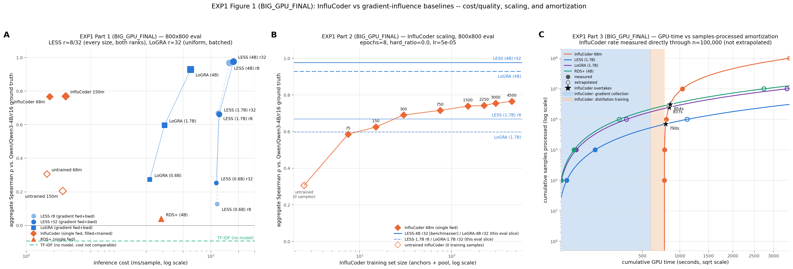

# InfluCoder: Distilling Decoders' Gradient Influence Rankings into an Encoder for Data Attribution

This repo contains the code for our AACL-IJCNLP 2026 paper
[Influcoder: Distilling Decoders' Gradient Influence Rankings into an Encoder for Data Attribution](TODO-paper-link).

Gradient-based data attribution methods such as LESS and LoGRA score every candidate example with a forward and a
backward pass through the target LM. **InfluCoder** distills these gradient-influence rankings into a small text
encoder, so that scoring a candidate at selection time costs a single encoder forward pass.



## 🔗 Quick Links
- [Install Requirements](#install-requirements)
- [Data](#data)
- [Quickstart](#quickstart)
- [Reproducing EXP1 (Figure 1)](#reproducing-exp1-figure-1)
  - [Step 1: Quality vs. cost of every method](#step-1-quality-vs-cost-of-every-method)
  - [Step 2: Scaling with the number of distillation samples](#step-2-scaling-with-the-number-of-distillation-samples)
  - [Step 3: Amortized cost](#step-3-amortized-cost)
  - [Step 4: Collect results and plot](#step-4-collect-results-and-plot)
- [Other Experiments](#other-experiments)
- [Repository Layout](#repository-layout)
- [Citation](#citation)

## Install Requirements

```bash
git clone <this-repo> && cd influcoder
conda create -n influcoder python=3.11 -y && conda activate influcoder
pip install -r requirements.txt
pip install "transformers>=4.51" traker   # EXP1 only: Qwen3 teachers + the LESS baseline
```

Optional: `pip install fast_jl` for TRAK's CUDA projector (faster LESS baseline).

## Data

| Data | Role | Where |
|---|---|---|
| BIG-Bench Hard | anchors (queries) | `data/eval/bbh/`, included |
| dolci-instruct | candidate pool in EXP1 | `tasksource/dolci-instruct`, downloaded automatically from the HF Hub |
| Dolly-15k | candidate pool in the quickstart | `data/dolly/dolly_data.jsonl`, included |

## Quickstart

A minimal end-to-end run (SmolLM2-135M teacher, `ettin-encoder-68m` student, BBH × Dolly), about one minute on a GPU:

```bash
python run.py --preset sanity     # smallest run + check of the gradient sketch
python run.py --preset tiny       # small but non-trivial distillation
```

It writes `runs_out/<preset>/results.json`, the Spearman agreement with the gradient ground truth before and after
distillation, plus the trained encoder:

```python
from sentence_transformers import SentenceTransformer
encoder = SentenceTransformer("runs_out/tiny/encoder")
```

## Reproducing EXP1 (Figure 1)

**Setup.** The ground truth is the gradient influence of a Qwen3-4B teacher: rank-16 LoRA gradients, cosine
similarity. Anchors are BBH, candidates are dolci-instruct, and the eval is 800 × 800. Every method is scored by the
Spearman correlation of its scores with this ground truth, against its inference cost (ms per candidate). All
parameters are in `experiments/exp1/config.py`, overridden for the paper setting by `experiments/exp1/config_biggpu.py`.

Run all commands from the repository root with the paper setting and a seed:

```bash
export EXP1_CONFIG=biggpu EXP1_SEED=0 EXP1_INFLUCODER_SEED=0 EXP1_DATA_SEED=0    # paper: seeds 0, 1, 2
```

The whole pipeline for all three seeds is one script: `bash scripts/exp1_figure1.sh`. One large GPU is enough
(tested on a 96 GB RTX PRO 6000; Step 1 takes about 1.5 h per seed). Outputs go to `results/fig1_dolci/biggpu/seed<k>/`.

### Step 1: Quality vs. cost of every method

```bash
python -m experiments.exp1.part1
```

Computes the Qwen3-4B gradient ground truth (cached after the first run), distills InfluCoder (68M and 150M
encoders), and scores InfluCoder, the untrained encoders, LESS and LoGRA at three teacher sizes (0.6B / 1.7B / 4B),
RDS+ and TF-IDF on the same eval. Output: `exp1_part1.json`.

### Step 2: Scaling with the number of distillation samples

```bash
python -m experiments.exp1.part2
```

InfluCoder quality as a function of the number of distillation examples. Output: `exp1_part2.json`.

### Step 3: Amortized cost

```bash
python -m experiments.exp1.part3
```

Cumulative GPU time against the number of candidates processed, including InfluCoder's one-time distillation cost.
Output: `exp1_part3_{influcoder,less_logra}.json`.

### Step 4: Collect results and plot

```bash
python -m experiments.exp1.collect_results     # -> EXP1_results.json
python -m experiments.exp1.plot_figure1        # -> figure1.{pdf,png}
```

The committed `results/fig1_dolci/biggpu/seed{0,1,2}/` hold the paper's numbers. Example (seed 0, aggregated
Spearman with the Qwen3-4B ground truth):

| Method | Spearman | ms / candidate |
|---|---|---|
| InfluCoder (68M encoder) | 0.77 | ~2 |
| Untrained encoder (68M) | 0.31 | ~2 |
| LESS (Qwen3-4B, rank 32) | 0.98 | ~176 |
| LoGRA (Qwen3-4B) | 0.93 | ~61 |
| LESS / LoGRA with the 0.6B proxy | 0.25 / 0.27 | ~114 / ~22 |

InfluCoder's distillation is not bit-reproducible on GPU, because the SDPA attention backward is non-deterministic.
Expect about ±0.02 between runs.

## Other Experiments

| Experiment | Command | Committed results |
|---|---|---|
| Loss-weight (α) ablation | `python -m experiments.exp1.part1_alpha_ablation` | `results/fig1_dolci/default/alpha_ablation.json`, summary in `experiments/exp1/ALPHA_ABLATION.md` |
| Index storage per 1K examples | `bash scripts/exp1_ablations.sh` | `results/addendum_storage_{1k,n100}.json` |
| DATE-LM: factual attribution (Counterfact) and toxicity filtering (XSTest) with Pythia-1B | `bash scripts/datelm.sh`, details in [`experiments/datelm/EXP2-GUIDE.md`](experiments/datelm/EXP2-GUIDE.md) | `experiments/datelm/exp2-*-final.json` |

## Repository Layout

```
influcoder/          the method: data loading, LoRA gradient features + CountSketch, encoder distillation, metrics
run.py               end-to-end InfluCoder pipeline (quickstart presets)
baselines/           LESS, LoGRA, RDS+, semantic, TF-IDF, random, scored on the same eval as InfluCoder
experiments/exp1/    EXP1: Figure 1 (Steps 1-4), alpha ablation, storage
experiments/datelm/  DATE-LM benchmark integration (vendored upstream code + our runners)
scripts/             one shell script per experiment
data/                BBH anchors, Dolly candidates
results/             result files behind the paper's numbers and figures
```

## Acknowledgements

`experiments/datelm/` vendors the [DATE-LM](https://github.com/DataAttributionEval/DATE-LM) benchmark.
`baselines/less/` and `baselines/logra/` adapt the [LESS](https://github.com/princeton-nlp/LESS) and LoGRA reference
implementations.

## Citation

```bibtex
@inproceedings{influcoder2026,
  title     = {Influcoder: Distilling Decoders' Gradient Influence Rankings into an Encoder for Data Attribution},
  author    = {TODO},
  booktitle = {Proceedings of AACL-IJCNLP 2026},
  year      = {2026}
}
```
